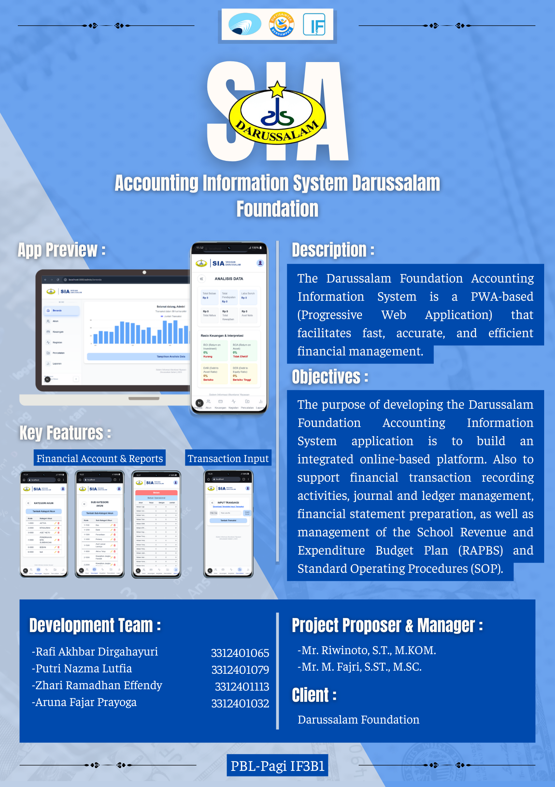
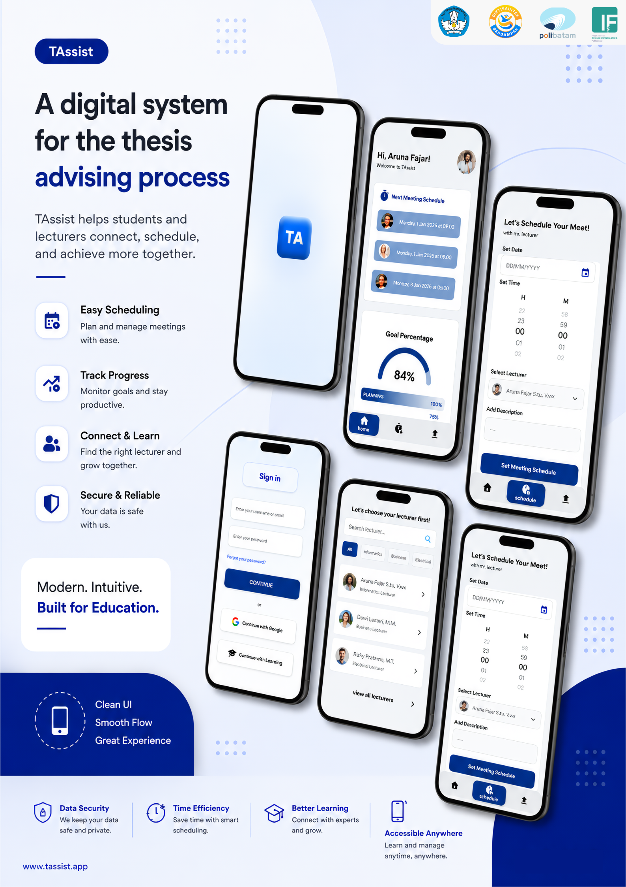
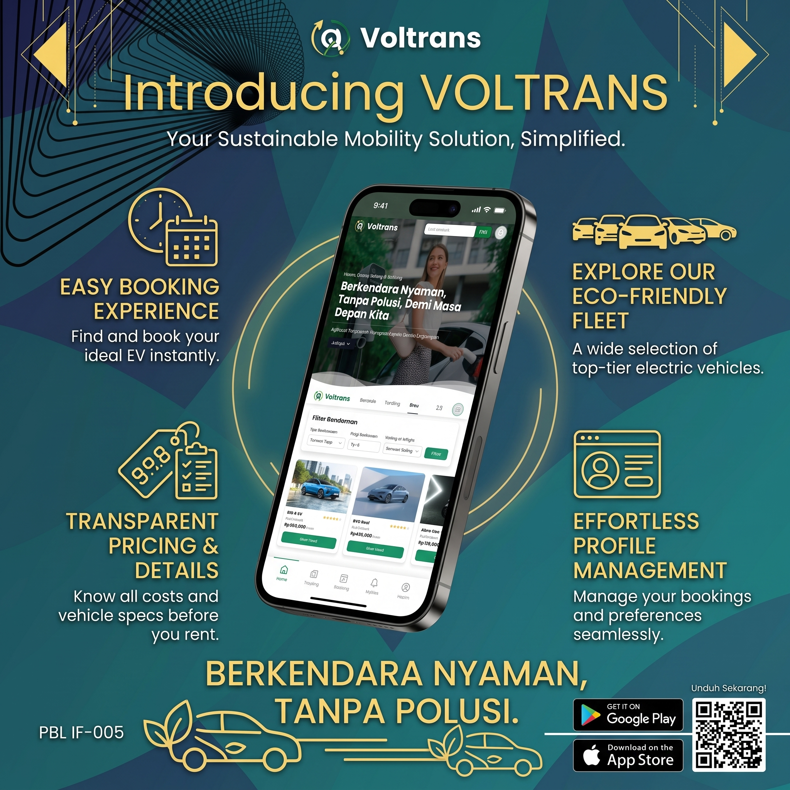

<p align="center">
  
</p>

<p align="center">
  <a href="https://github.com/fajar288/Porto">
    
  </a>
</p>

<p align="center">
  <a href="https://github.com/fajar288/Porto" target="_blank">
    
  </a>
  <a href="https://github.com/fajar288" target="_blank">
    
  </a>
  <a href="https://www.linkedin.com/in/fajar-prayoga-374309353/" target="_blank">
    
  </a>
  <a href="https://www.instagram.com/arronhry/" target="_blank">
    
  </a>
  <a href="mailto:fajrzprayoga@gmail.com">
    
  </a>
</p>

---

## `01` ABOUT ME

<table>
<tr>
<td width="55%" valign="top">

Hi, I'm **Aruna Fajar Prayoga** — an Informatics student at **Politeknik Negeri Batam** based in **Batam, Indonesia**.

With **2+ years of experience** and **7+ completed projects**, I specialize in building **accessible, performant, and visually engaging** web & mobile products.

- **Web & Full-Stack:** Next.js, React, Laravel, Node.js, Express
- **Mobile Apps:** Cross-platform Android & iOS with Flutter & Dart
- **Community:** Active in **Polibatam English Club (PEC)** & **PBL Teams**
- **Focus:** Clean UI/UX, scalable backend APIs, & real-world impact

</td>
<td width="45%" valign="top">

```ts
const aruna = {
  role: "Full-Stack & Mobile Dev",
  location: "Batam, Indonesia",
  campus: "Politeknik Negeri Batam",
  experience: "2+ Years",
  projectsShipped: "7+ Projects",
  coreStack: [
    "Next.js",
    "Laravel",
    "Flutter",
    "MySQL / PostgreSQL"
  ],
  openToWork: true
};
```

</td>
</tr>
</table>

---

## `02` TECH ARSENAL

<div align="center">

| Frontend & Mobile | Backend & Database | Tools & Design |
| :---: | :---: | :---: |
|  |  |  |

</div>

---

## `03` FEATURED PROJECTS

<table>
<tr>
<td width="33%" valign="top">

<p align="center">
  <a href="https://github.com/fajar288/Porto/blob/main/projects/sia.html">
    
  </a>
</p>

### SIA Darussalam Foundation
PWA accounting system for financial records, journal & ledger bookkeeping, RAPBS budgeting, and automated ratio analytics (**ROI, ROA, DAR, DER**).

`Next.js` · `Laravel` · `MySQL`

</td>
<td width="33%" valign="top">

<p align="center">
  <a href="https://github.com/fajar288/Porto/blob/main/projects/tassist.html">
    
  </a>
</p>

### TAssist — Thesis App
Cross-platform mobile platform connecting students and lecturers with smart meeting scheduling, advisor discovery, and milestone tracking.

`Flutter` · `Dart` · `Laravel`

</td>
<td width="33%" valign="top">

<p align="center">
  <a href="https://github.com/fajar288/Porto/blob/main/projects/voltrans.html">
    
  </a>
</p>

### Voltrans — EV Rental
Sustainable electric vehicle rental web app featuring multi-criteria fleet filtering, transparent pricing, and seamless booking history.

`PHP` · `Laravel` · `DaisyUI`

</td>
</tr>
</table>

---

## `04` CERTIFICATIONS & STATS

<table>
<tr>
<td width="52%" valign="top">

### Certifications
- **Certificate of Appreciation — Polibatam English Club (PEC)**  
  *Politeknik Negeri Batam · Jan 2026*
- **Meta Front-End Developer Professional Certificate**  
  *Coursera · Nov 2023*
- **Digital Literacy Seminar (Digital Safety Education)**  
  *Ministry of Communication and Information Technology RI*

<br />


</td>
<td width="48%" valign="middle" align="center">


</td>
</tr>
</table>

---

<p align="center">
  
</p>
